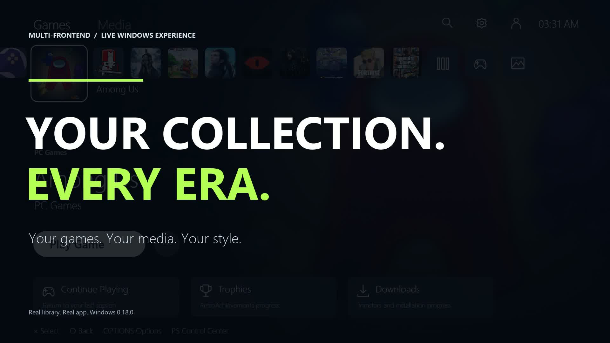

# Multi-Frontend

A controller-friendly game and media frontend for Windows and Android. The application is currently named **Blades360**.

[Download Windows and Android builds](https://github.com/nahalewski/Multi-Frontend/releases/latest)

## Latest desktop screenshots and feature video

[](docs/media/README.md)

[Watch the commercial](docs/media/README.md) · [Browse 51 screenshots by console theme and app](docs/previews/README.md)

The new video shows the **live Windows 0.18.0 development build**, real game artwork and connected media, with 12 theme/anniversary looks including Vita and Switch, plus a new 150 BPM soundtrack. The older screenshot gallery uses 0.16.0 demonstration content. Published builds and the source snapshot below remain **0.12.0** for Windows; Android has a separate feature set.

## Current builds

| Platform | Version | Status |
| --- | --- | --- |
| Windows x64 | 0.12.0 | Portable development build; six console-inspired themes |
| Android 8+ | 1.0 | Debug-signed development APK; Blades theme |

Android does **not** yet contain the desktop XMB theme or karaoke/community updates. Version numbers and feature sets are separate. macOS source/build tooling is present, but this release does not provide a tested Mac binary.

## Features

- Windows themes: Blades, NXE, Metro, revised Metro, Xbox Series, and PlayStation 3 XMB. First-run setup offers console/theme selection with a live preview.
- ROM and PC game libraries, artwork, RomM catalog/downloads, emulator discovery, core downloads, console launch screens, BIOS folder and supported save/state controls.
- Controller navigation and remapping, on-screen keyboard, themed overlays and notifications, RetroAchievements data, storage management and settings backup.
- Local music and app captures, Jellyfin, Plex, YouTube, and IPTV playlists/programme guide. Bring your own service accounts and content.
- Desktop RomM save backups after games exit, subject to server configuration and supported save paths.
- Desktop karaoke: lyrics, vocal separation, remote duets, recordings, community sharing, ratings, and consent-based replacement/addition of vocal stems.
- Optional multiplayer accounts; local use does not require registration.

## XMB update in 0.12.0

Refined category icons, trophy/saved-data icons, menu row spacing, layered animated waves and fading PS3 startup presentation. Navigation and startup audio are selected per theme. Menus remain interactive, rendered UI—not screenshots. See [asset sources](desktop/assets/xmb/SOURCES.md).

## Install

**Windows:** download and run `Blades360-0.12.0-win-x64.exe`. This portable build is unsigned. Settings live in the current user's application data, not this repository.

**Android:** install `Blades360-android-1.0-debug.apk` using Android's package installer or `adb install -r`. It is a development APK, not a Play Store release. A differently signed existing installation cannot be updated in place; back up settings before replacing it.

Configure your own ROM/media folders and accounts in the app. No ROMs, BIOS, firmware, passwords, API keys, private profiles, or server databases are included. Emulator availability and game compatibility vary by platform.

## Build from source

Windows requires Node.js/npm and Windows 10/11:

```powershell
cd desktop
npm ci
npm test
npm start
npm run build:win
```

Android requires JDK 17+ and Android SDK 35. Set `ANDROID_HOME` or create an untracked `local.properties` with `sdk.dir`, then:

```powershell
.\gradlew.bat :app:assembleDebug :app:assembleDebugAndroidTest
```

The Gradle 8.10.2 wrapper verifies its distribution checksum. APKs appear in `app/build/outputs/apk/`. Instrumentation tests need a connected compatible Android device; compiling the test APK does not execute them.

Desktop UI checks run through Electron, for example `npx electron tests/xmb-smoke.cjs`. Tests use fixtures, not personal accounts. The independent service is in [multiplayer](multiplayer/README.md); it needs Node.js, FFmpeg, Python and optional vocal-separation/transcription models. Deployment is separate from the desktop executable. The Windows startup installer requires your own Cloudflare tunnel ID and hostname. The frontend currently targets the project's configured service URL; self-hosting also requires updating the frontend URL/CSP and server public origin.

## Known limitations / next milestones

- Emulator-specific netplay, account recovery, friends/invites and pitch scoring remain unfinished.
- Remote duet monitoring has internet latency. Vocal separation can leave artifacts.
- Replacing a singer requires isolated vocal stems; a mixed recording alone cannot cleanly separate performers.
- Android parity with desktop XMB and karaoke/community remains future work.
- Some system integrations require installed emulators, Windows tools, compatible hardware or permissions. Theme recreations are not official console firmware.

## Credits

This is an independent project, not affiliated with Microsoft, Sony, Nintendo or media providers. Existing asset licenses and attribution remain alongside the assets, including LibretroDroid, EmulatorJS, libretro cores and theme resources. Third-party console graphics/audio retain their owners' rights; repository visibility does not relicense them. No blanket license is asserted over third-party assets.
