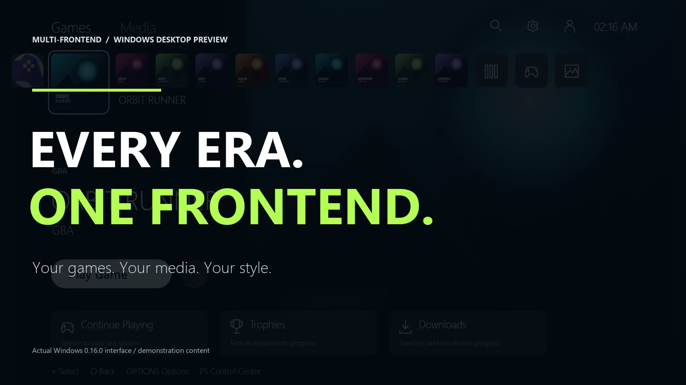

# Multi-Frontend live feature video

**1:33 | 1920 x 1080 | 30 fps | H.264/AAC | Original 150 BPM soundtrack**

[Play or download the MP4](https://raw.githubusercontent.com/nahalewski/Multi-Frontend/main/docs/media/Multi-Frontend-Live-Features-0.18.0.mp4)

Recorded from the actual Windows 0.18.0 development app, using a private copy of the real local profile and its real 28-game library. No synthetic game covers, sample media titles, mock service replies, or fabricated guide data were used. Presentation settings were isolated from the normal profile.

Twelve console/anniversary looks include Vita and Switch. The tour shows real library navigation, themed menus, emulator choices, the connected Jellyfin collection, provider programme data, RetroAchievements profile, karaoke tools, controllers, saves, avatars and backup settings. The IPTV segment demonstrates guide browsing; its preview is still connecting. Menu footage does not establish gameplay, streaming, or duet completion.

Empty YouTube and incomplete RomM/Plex artwork views were left out rather than replaced with mock content. The older 0.16.0 screenshot gallery and video remain archived demonstration material, not the source for this live edit.

The new original instrumental, **High Voltage**, uses a 150 BPM beat, heavier kick and bass, builds, drops and beat-aligned cuts. No commercial song recording was used.

The public Windows release/source is now 0.19.0. This video records 0.18.0 and predates the Wii/Wii U themes; Android has a separate feature set.

## Chapters

- **0:00** - YOUR COLLECTION.
- **0:06** - BLADES
- **0:08** - NXE
- **0:10** - METRO
- **0:11** - METRO REVISED
- **0:13** - XBOX SERIES
- **0:14** - 25TH ANNIVERSARY
- **0:16** - PLAYSTATION 3 / XMB
- **0:18** - PLAYSTATION 4
- **0:19** - PS4 ANNIVERSARY
- **0:21** - PLAYSTATION 5
- **0:22** - PLAYSTATION VITA
- **0:24** - NINTENDO SWITCH
- **0:26** - YOUR GAMES. ALL TOGETHER.
- **0:32** - A DIFFERENT WAY TO PLAY.
- **0:35** - BUBBLES. LIVEAREA. START.
- **0:38** - STAY IN CONTROL.
- **0:42** - KEEP THE FAMILIAR FEEL.
- **0:45** - CHOOSE YOUR ENGINE.
- **0:48** - YOUR MEDIA. YOUR SERVER.
- **0:54** - FIND YOUR NEXT CHANNEL.
- **1:01** - KEEP TRACK OF YOUR PROGRESS.
- **1:04** - MORE THAN A GAME LIBRARY.
- **1:07** - TAKE THE MIC.
- **1:10** - BUILT FOR THE COUCH.
- **1:14** - KEEP YOUR PROGRESS CLOSE.
- **1:17** - MAKE IT YOURS.
- **1:20** - YOUR SYSTEM. YOUR STYLE.
- **1:23** - TAKE YOUR SETTINGS WITH YOU.
- **1:26** - MULTI-FRONTEND

Console and service names/logos belong to their respective owners. Multi-Frontend is independent and unaffiliated.
